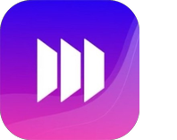

# Hey, I’m Connor.

I love building software, especially apps. There’s something satisfying about taking an idea, working through the details, and putting something in people’s hands.

I’ve built apps from the ground up, rebuilt an existing app for iOS and Android, and worked on the things that need to hold up after launch, from offline functionality to subscriptions and releases. My background is in native iOS, and I also build with React Native and TypeScript.

Right now, I’m a software engineer at Covr, working on two mobile apps and helping the team adopt AI tools in its development workflow.

## Some of the apps I’ve worked on

**IntelliCharge** · Grid Elevated 
I rebuilt the existing app in SwiftUI for iOS, used Skip to bring it to Android, and took both versions through store review.

 

**CxAlloy** 
I worked on the SQLite layer that supports offline use for people working in the field, as well as the app’s move to Liquid Glass.

 

**Muunifi** · 808 Partners 
I worked on offline sync, subscriptions, and payouts for an app used by finance creators.

 

**LBH Skincare** · 808 Partners 
I built an app that helps skincare teams learn about products and place orders, taking it from concept through launch.

 

**Rewire** · Personal project 
A recovery tracker for people using the Sinclair Method, built with Swift and CloudKit.

 

## What I’m building outside of work

I tend to have a few projects going at once. Lately, that includes Lagoona, a Sudoku app in TestFlight; Drawn, an iOS game; and ChewedGumGames, an arcade I’m building for friends.

I enjoy having a place to try ideas, learn new things, and build the kinds of apps and games I want to use myself.

## Tools I work with

Swift, SwiftUI, UIKit, SQLite, CloudKit, React Native, TypeScript, and Skip.

[Portfolio](https://connorhammond.dev) · [LinkedIn](https://www.linkedin.com/in/connor-hammond-ios/)
